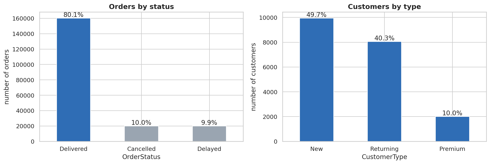
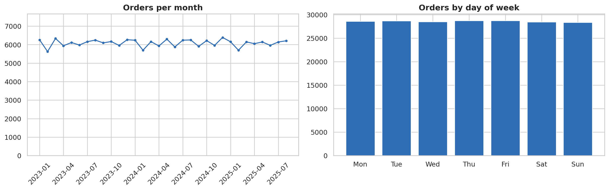
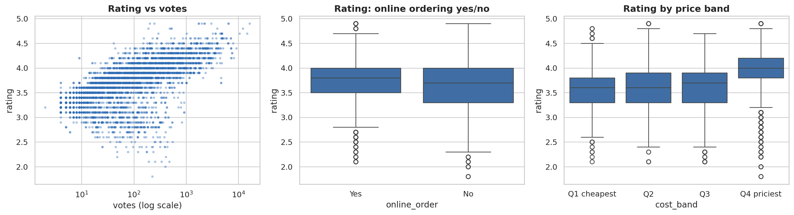
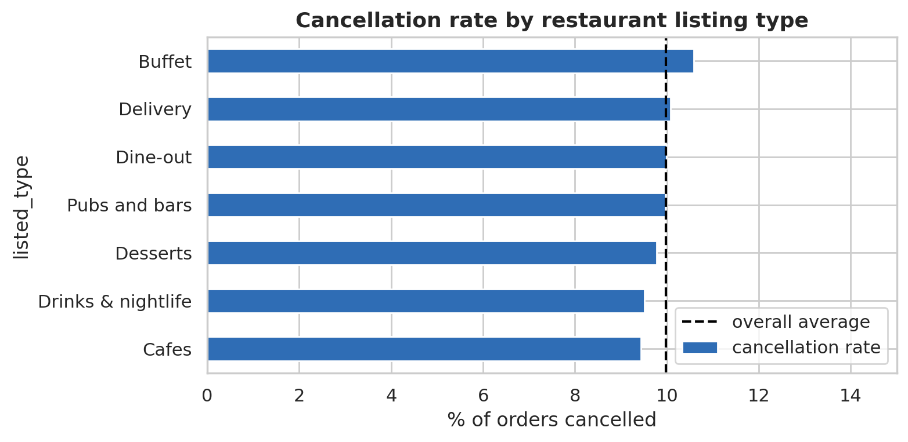
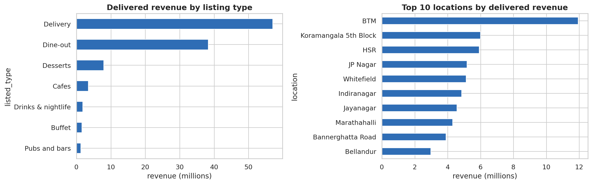
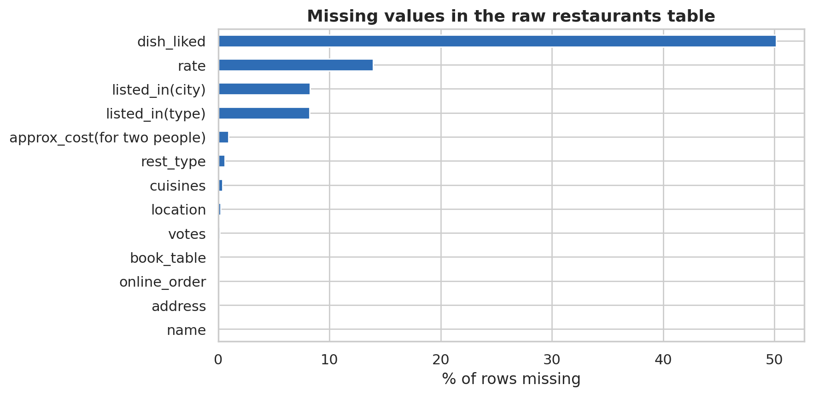
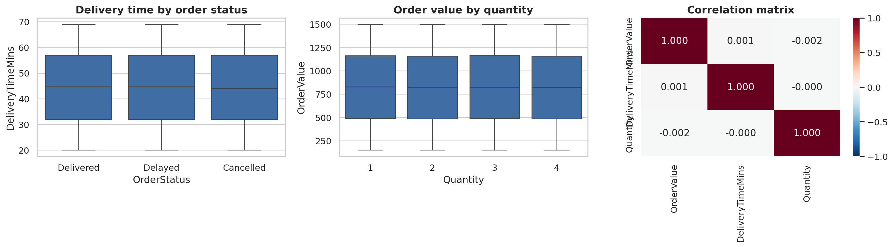
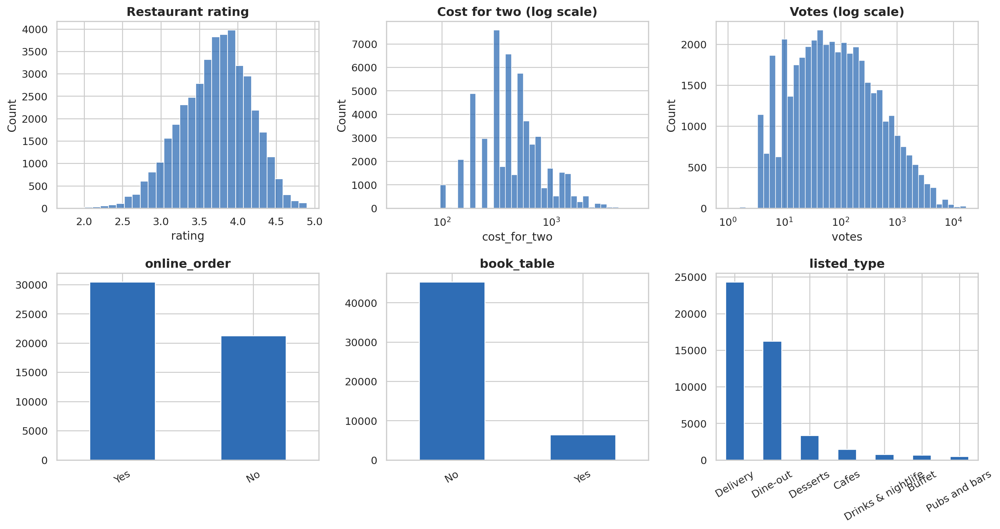

<div align="center">

# 🍔 Food Delivery EDA

**Exploratory data analysis of online food orders, customers and restaurant listings**


</div>

---

## 📌 Overview

This project explores a food delivery dataset made of four linked tables: **customers**, **orders**, **restaurants** and a **calendar** table. The goal is to clean messy raw data, join everything into one master table, and answer practical business questions:

- How many orders are **delivered, delayed or cancelled**, and what drives the problems?
- How do **orders and revenue change** across months, quarters and days of the week?
- Which **customer types, restaurant types and locations** bring the most value?
- Do ratings, price and online ordering actually relate to each other?
- Are the differences we see **statistically significant**, or just noise?

Everything lives in one notebook, written to be read top to bottom.

---

## 📑 Table of contents

- [Dataset](#️-dataset)
- [What the notebook does](#-what-the-notebook-does)
- [Charts explained](#-charts-explained)
- [Getting started](#-getting-started)
- [Tech stack](#-tech-stack)
- [Project structure](#-project-structure)
- [Highlights](#-highlights)
- [Future work](#-ideas-for-future-work)

---

## 🗂️ Dataset

The four CSV files are in the root of this repo, next to the notebook.

| File | What it contains | Key columns |
|---|---|---|
| `customers.csv` | One row per customer | `CustomerID`, `City`, `CustomerType`, `SignupDate` |
| `orders.csv` | One row per order | `OrderID`, `CustomerID`, `RestaurantID`, `OrderDate`, `OrderValue`, `DeliveryTimeMins`, `Quantity`, `OrderStatus` |
| `restaurants.csv` | Restaurant listings | `RestaurantID`, `name`, `location`, `rest_type`, `cuisines`, `rate`, `votes`, `approx_cost(for two people)`, `online_order`, `book_table`, `listed_in(type)`, `listed_in(city)` |
| `datatable.csv` | Calendar lookup table | `Date`, `Year`, `MonthNo`, `MonthName`, `Quarter` |

---

## 🔍 What the notebook does

### 1. Load and inspect
- Reads all four tables (handles the hidden BOM character in CSV headers)
- Checks shapes, data types, date ranges, missing values and duplicates
- Confirms that ID columns are unique

### 2. Clean the data
- Detects **corrupted rows** in the restaurants table (invalid `online_order` / `book_table` values) and removes them
- Converts `rate` (like `4.1/5`) into a numeric `rating`; `NEW` and `-` become missing
- Converts `votes` and `cost_for_two` into numbers
- Flags orders linked to removed restaurants
- Flags **logically impossible orders** placed before the customer's signup date

### 3. Build a master table
- Joins orders with customers, calendar and restaurant details
- Includes a safety check (`assert`) so a join can never silently duplicate rows

### 4. Explore
| Area | Analysis |
|---|---|
| **Distributions** | Order value, delivery time, quantity, skewness, medians |
| **Order status** | Delivered vs delayed vs cancelled |
| **Time trends** | Orders per month, per quarter and by day of week (incomplete last month excluded) |
| **Customers** | Orders per customer, top areas, signups over time, customer type comparison |
| **Restaurants** | Rating, price and votes distributions, online ordering and table booking share |
| **Relationships** | Spearman correlations, rating vs votes, rating vs price band |
| **Problem rates** | Cancellation and delay rates by customer type, quantity, weekday and listing type |

### 5. Hypothesis tests (α = 0.05)

| # | Question | Test |
|---|---|---|
| 1 | Is order status related to customer type? | Chi-square + Cramér's V |
| 2 | Does delivery time differ between statuses? | One-way ANOVA |
| 3 | Does order value differ between customer types? | Kruskal-Wallis |
| 4 | Are order value and quantity correlated? | Pearson |
| 5 | Do online-ordering restaurants rate differently? | Mann-Whitney U |

### 6. Outliers and revenue
- IQR-based outlier detection for order value, delivery time, cost for two and votes
- Delivered revenue by listing type and by location
- Top restaurants by revenue and the share of revenue from the top 10% of restaurants

### 7. KPI summary
Total orders, date range, active customers, delivered / cancelled / delayed %, average order value, delivered revenue, revenue lost to cancellations and average delivery time.

---

## 🖼️ Charts explained

Each chart below is saved by the notebook as a PNG. Here is what each one shows and how to read it.

---

### 1. Order status and customer types

<p align="center">
  
</p>

**What it shows:** Two bar charts side by side. The left one counts orders by status (Delivered, Delayed, Cancelled), with the share of all orders printed on top of each bar. The right one counts customers by type, also with percentages.

**How to read it:** Taller bars mean more orders (or customers). The percentage labels make it easy to compare groups without doing any maths.

**Why it matters:** This is the starting point of the whole analysis. It shows how healthy the delivery operation is, and how the customer base is split.

---

### 2. Order trends over time

<p align="center">
  
</p>

**What it shows:** A line chart of orders per month (left) and a bar chart of orders by day of week (right). The last month in the data is left out because it is incomplete, which would make the line drop for the wrong reason.

**How to read it:** On the line chart, look for upward or downward trends and repeating seasonal peaks. On the bar chart, compare the weekdays to see which days are busiest.

**Why it matters:** Time patterns help with staffing, delivery capacity and promotion timing.

---

### 3. Rating, votes, online ordering and price

<p align="center">
  
</p>

**What it shows:** Three plots about restaurant ratings:
1. A scatter plot of rating vs votes (votes on a log scale, 5,000 random restaurants)
2. A box plot of rating for restaurants with and without online ordering
3. A box plot of rating across four price bands (cheapest to priciest quarter)

**How to read it:** In a box plot, the line in the middle is the median, the box holds the middle 50% of restaurants, and the dots are outliers. In the scatter plot, a clear upward or downward slope means rating and votes move together.

**Why it matters:** It tests common assumptions, such as whether expensive restaurants are rated higher, or whether offering online ordering goes with better ratings.

---

### 4. Cancellation rate by listing type

<p align="center">
  
</p>

**What it shows:** Horizontal bars with the percentage of orders cancelled for each restaurant listing type. The dashed vertical line is the overall average cancellation rate.

**How to read it:** Bars that reach past the dashed line are above average, so those listing types lose more orders than usual. Bars short of the line are better than average.

**Why it matters:** It points to the parts of the business where cancellations are concentrated, which is where fixing the problem pays off most.

---

### 5. Revenue by listing type and location

<p align="center">
  
</p>

**What it shows:** Two horizontal bar charts of **delivered** revenue (in millions). The left one splits revenue by restaurant listing type. The right one shows the top 10 locations.

**How to read it:** Longer bars mean more revenue. Only delivered orders are counted, so cancelled orders do not inflate the numbers.

**Why it matters:** It shows where the money actually comes from, which helps decide where to focus marketing, partnerships and delivery coverage.

---

### 6. Missing values in the raw restaurants table

<p align="center">
  
</p>

**What it shows:** The percentage of missing values in each column of the raw restaurants table, before any cleaning.

**How to read it:** The longer the bar, the more of that column is empty. Columns with very long bars may need to be dropped or handled carefully.

**Why it matters:** Checking missing data first decides how much each column can be trusted in later steps.

---

### 7. Delivery time, order value and correlations

<p align="center">
  
</p>

**What it shows:** Three plots about orders:
1. Delivery time for each order status (box plot)
2. Order value for each quantity (box plot)
3. A correlation heatmap for order value, delivery time and quantity

**How to read it:** In the heatmap, numbers close to **+1** mean two columns rise together, close to **-1** mean one rises as the other falls, and close to **0** means no linear link. Red and blue shades show the direction.

**Why it matters:** It checks whether slow deliveries line up with delays or cancellations, and whether bigger orders really cost more.

---

### 8. Distributions of restaurant features

<p align="center">
  
</p>

**What it shows:** Six small charts about the restaurants table: histograms of rating, cost for two (log scale) and votes (log scale), plus bar charts for online ordering, table booking and listing type.

**How to read it:** Histograms show how values are spread. A log scale is used for cost and votes because a few very large values would otherwise squash everything else into one corner.

**Why it matters:** It gives a quick profile of the restaurant market: how well restaurants are rated, how pricey they are, and how common online ordering and table booking are.

---

## 🚀 Getting started

### Option A: Google Colab
1. Open `food_delivery_eda.ipynb` in Colab
2. Upload the four CSV files to the session storage
3. Run all cells

### Option B: Run locally
```bash
# 1. Clone the repo
git clone https://github.com/khosnurshuchi/food-delivery-eda.git
cd food-delivery-eda

# 2. Install dependencies
pip install pandas numpy matplotlib seaborn scipy jupyter

# 3. Launch the notebook
jupyter notebook food_delivery_eda.ipynb
```

> The notebook saves its charts into an `images` folder when you run it. The PNGs in this repo are copies of those charts.

---

## 🧰 Tech stack

| Tool | Used for |
|---|---|
| **pandas** | Cleaning, merging, aggregation |
| **NumPy** | Numeric operations |
| **Matplotlib / Seaborn** | Charts (one main colour, one neutral, for clean visuals) |
|
